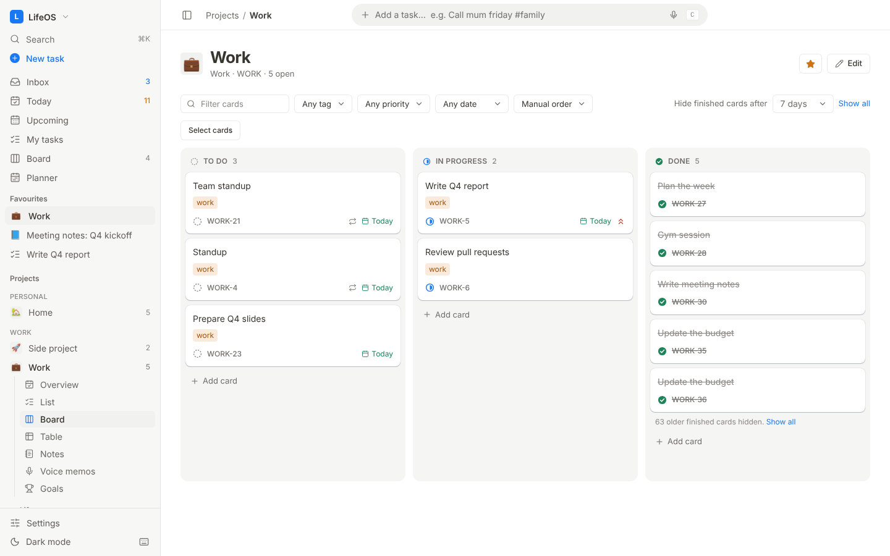
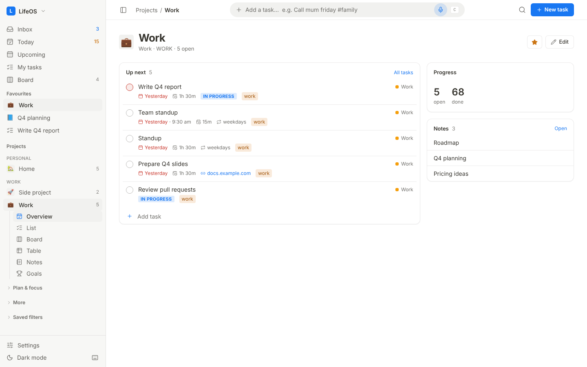
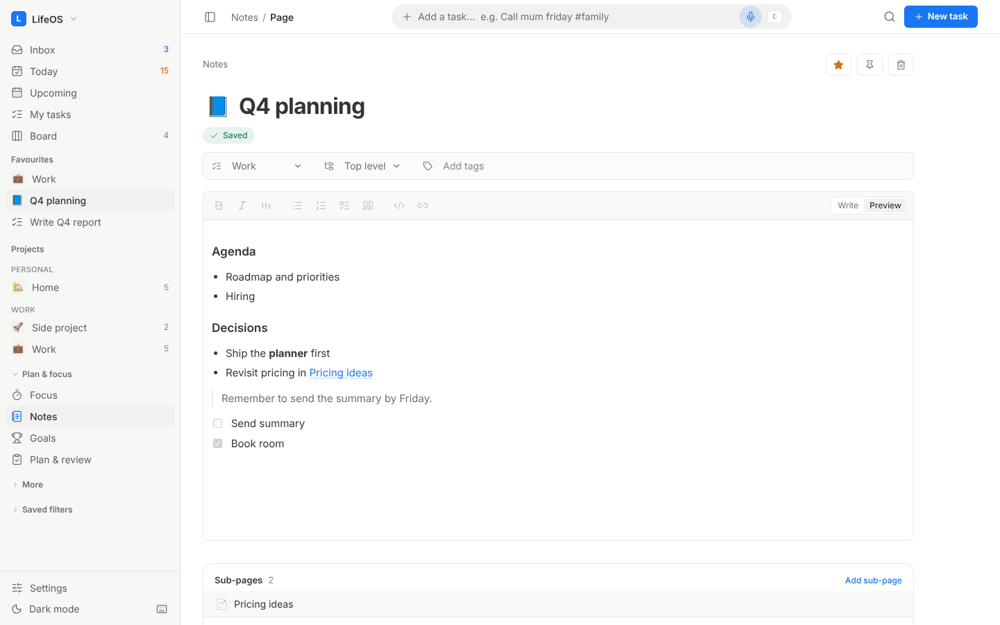
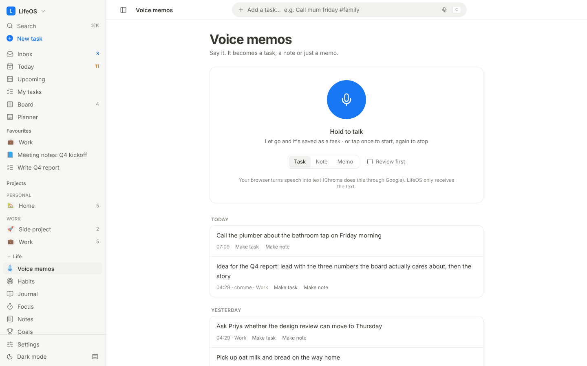
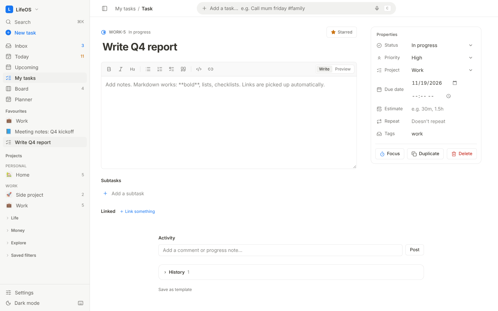

# LifeOS

A personal, single-user workspace that mixes Trello, Notion and Confluence: tasks and boards, projects with their own views, wiki-style notes, voice memos, habits, journal and more. Everything is switchable.
Next.js 15 + SQLite (better-sqlite3). Self-hosted, with a REST API, an MCP server and a background worker.

## Screenshots

| | |
|---|---|
|  **Today**: tasks, calendar, habits and journal in one place |  **Project board**: each project has its own columns, filters and bulk edit |
|  **Project workspace**: overview, list, board, table, notes, voice memos and goals per project |  **Notes**: pages and sub-pages, backlinks, history and links to tasks |
|  **Voice memos**: hold to talk, let go and it becomes a task, note or memo |  **Week view**: drag tasks between days |
|  **Task**: markdown notes, subtasks, links, comments and history |  **Dark mode** |

On a phone it uses a bottom bar and one board column at a time:


(The screenshots use made-up demo data.)

## Deploy
Docker Compose + Cloudflare Tunnel + Access: see **[docs/DEPLOY.md](docs/DEPLOY.md)** (specs, setup, updates, recovery).

## Run
```bash
npm install
npm run dev                      # http://127.0.0.1:3000
npm run build && npm start       # production, binds 127.0.0.1
npm run worker                   # reminders, morning brief, IMAP email import (optional, keep it running)
npm run mcp                      # MCP server for Claude and other bots (optional)
LIFEOS_DB=data/demo.db npm run seed   # fill a demo database
```
Data lives in `data/lifeos.db` (override with `LIFEOS_DB`). Back it up from **Settings → Your data**.

## Switch features on and off
**Settings → Features.** Everything except Today, Inbox, My tasks and Settings can be turned off: Upcoming, Board, Plan & review,
Insights, Habits, Journal, Focus, Planner, Notes, Goals, People, Templates, Budgets, Subscriptions, Calendar sync, Telegram, the AI assistant (off by default), News, Weather, Music, Email import, Reminders, REST API. A switched-off feature disappears from the
sidebar, mobile nav, command palette, shortcuts, Today, the MCP tools, the REST API and the worker. Data is kept if you turn it back on.

## What's in it
**Tasks:** projects, tags, priority, due date **and time**, **estimates**, repeats, **subtasks/checklists** (recurring checklists reset),
quick-add syntax (`Pay rent every month #bills @home !high 31 march at 9am ~30m`), soft-delete with **Undo** (30 days), duplicate.
**Views:** Today (with workload meter), **Inbox**, **Upcoming** (agenda + month), My tasks, Board, **Search** with operators
(`#tag @project due:week is:done no:date has:link source:email`), **Plan your day / weekly review** (one-tap triage), **Insights**
(heatmap, streaks, focus), **Habits** (streaks that skip unscheduled days), **Journal** (mood + daily note).
**Speed:** `⌘K` palette (searches tasks too), `C` capture, `J/K/X/E/T/W/#` in lists, `?` for help, hover quick-reschedule.
**Phone:** installable PWA, share-sheet "Share to LifeOS", bottom tab bar, floating `+`.

**Money:** monthly **budgets** per category (default + per-month overrides), transactions, `$12.50 coffee` quick-add from anywhere, rules that auto-categorise by payee, **bank CSV import** (delimiter/date/debit-credit detection, de-duplicated), month projection and threshold alerts, savings goals. **Subscriptions:** cycle maths, auto-logged renewals, free-trial and renewal reminders, price-rise detection, monthly/yearly totals.
**Planning & life:** **Planner** (time-blocking timeline, auto-schedule into free slots, synced calendar events), **Notes** (Markdown, `[[links]]`, backlinks), **Goals** with key results, **People** (catch-up cadence, birthdays), **Templates** (one click makes a task with its checklist), **Do this now**, **Priority matrix**, **Trash**, saved filters, bulk select, task comments, link-title enrichment, voice capture (where the browser supports it), quiet hours.
**Board:** custom columns (add, rename, reorder, remove) with a *kind* (To do / In progress / Done) so counts and reminders keep working, optional **per-project columns**, add cards straight into a column, click a card to open it, and finished cards hide after N days. **Projects** are hubs: tasks, board, notes and goals. **Tags** on tasks, notes, goals and people. **History** on tasks, notes and goals (with restorable note versions) plus an Activity page. Voice is hold-to-talk: let go and it's added as a task.
**Customise:** Reorder, hide or show sidebar pages from the LifeOS menu → Edit sidebar (desktop). Settings → Layout picks the (up to 4) tabs in the phone's bottom bar and the order of Today's side panels.

## Also in it

- Search across tasks, notes, goals, people, voice memos and projects (`⌘K` or `/search`)
- Manual ordering of tasks and board cards (drag), board filters/sort, select mode with bulk edit, subtask progress on cards
- Table view for tasks; week view (drag to reschedule) on Upcoming
- Links between any two items (shown on both sides)
- Tags page: rename, merge, recolour, delete
- Import from Todoist CSV, generic CSV, and Markdown/text (Notion exports) in Settings, plus a fuller JSON export
- Edit conflicts on notes are detected across devices (keep mine / use theirs / keep both)
- Mobile board column tabs; sidebar editing in Settings

## More

- Settings are organised into tabs (General, Reminders, Connections, Data & backup). The Chrome extension can be downloaded from Settings → Connections, with a default project for its voice memos.
- Projects open to a view you choose (e.g. Board), can be reordered by dragging within their area, and tasks can be dragged onto a project in the sidebar to move them.
- Voice memos live in the Inbox (a tab), and are filed under a project when recorded inside one. Planner is reachable from Today's Timeline button.
- Browser reminders: while LifeOS is open, timed tasks pop up a notification with Mark done and Snooze (15 minutes by default).
- Subscriptions: weekly, fortnightly, monthly, quarterly, half-yearly and yearly; a Pay run lists the charges in a week, fortnight, month or year so you can tick off what you've paid.

## Projects, layout

Each project is its own workspace with tabs: Overview, List, Board, Table, Notes, Voice memos and Goals, all filtered to that project. Anything recorded or created inside a project is filed under it. The sidebar can be hidden with the button in the top bar (or `[`), and boards, tables, projects and the week view use the full width.

## Upgrading

Run `./update.sh` in your checkout. It pulls, builds the image once (web, worker and MCP share it), restarts what changed and tidies old images. Database changes are additive, and a copy of your database is saved next to it before any schema upgrade (currently schema v7).

Builds reuse a compile cache, so the first one after this change is slow (several minutes on a small machine) and later ones are much quicker. If it is still slow, `docker compose build --progress=plain web` shows which step takes the time.

**Fastest of all: run it without Docker.** On a small machine most of the time is Docker re-exporting the image, not compiling. Running the app directly keeps Next.js's build cache in the folder, so an update is usually under a minute:

```
git pull && npm ci && npm run build && sudo systemctl restart lifeos lifeos-worker lifeos-mcp
```

(or `pm2 restart all`). You'd run `npm start`, `npm run worker` and `npm run mcp` under systemd or pm2, with the same `.env`. Keep using Docker if you prefer the isolation.

## Integrations
| What | How |
|---|---|
| **Claude / MCP** | `LIFEOS_MCP_TOKEN=$(openssl rand -hex 24) npm run mcp`, then `tailscale serve --bg --https=8443 http://127.0.0.1:3737` and `claude mcp add --transport http lifeos https://<machine>.<tailnet>.ts.net:8443/mcp --header "Authorization: Bearer <token>"`. 30 tools; they follow the feature switches. Never use `tailscale funnel`. |
| **REST API** | Settings → API & calendar feed → create a token. `POST /api/v1/tasks {"text":"Call mum tomorrow at 5pm"}`, `GET /api/v1/tasks?q=`, `PATCH/DELETE /api/v1/tasks/:id`, `POST /api/v1/tasks/:id/complete`, `/search`, `/brief`, `/habits`, `/journal`. Good for iOS Shortcuts and scripts. |
| **Email to tasks** | Webhook: POST any email (Postmark, Mailgun, SendGrid, JSON, or raw RFC 822 from a Cloudflare Email Worker) to the URL in Settings. Or IMAP: set `LIFEOS_IMAP_HOST/USER/PASS` (+ `_MAILBOX`, `_FLAGGED_ONLY=1`) and run the worker. Subject accepts quick-add syntax; `tasks+work@` adds the tag `work`; duplicates are skipped. |
| **Calendar** | Subscribe to the iCal URL in Settings from Google/Apple/Outlook. Repeats come through as RRULEs. |
| **Push** | ntfy topic and/or any webhook in Settings; due-time reminders, morning brief, evening habit nudge. Needs `npm run worker` and `LIFEOS_BASE_URL` for tap-through links. |
| **Calendar sync** | Settings → Calendar sync: paste a private `.ics` link (Google: "Secret address in iCal format"). Read-only, refreshed by the worker every ~15 min. |
| **Telegram** | Create a bot with @BotFather, paste the token in Settings → Telegram, send the shown `/start <code>` to link your chat. Default is **polling** (the worker fetches messages; no public URL). Webhook mode is optional. Only that chat is answered. Free text adds a task; `/today /inbox /done 12 /search /brief /habits /spent 12 coffee /subs`. |
| **AI assistant** | Off by default. Set `ANTHROPIC_API_KEY`, switch it on in Settings; smart paste, plan-my-day and ask. Model `claude-opus-5-5` (override `LIFEOS_AI_MODEL`). Text is sent to Anthropic only when you press a button. |
| **Voice memos / Chrome extension** | `/voice` records speech (browser speech recognition) into a memo, task or note. `extension/` is an unpacked Chrome extension: toolbar icon or Alt+Shift+V opens a recorder window that POSTs text to `/api/v1/voice`. See `extension/README.md`. |
| **Spotify** | `SPOTIFY_CLIENT_ID`, `SPOTIFY_CLIENT_SECRET`, `LIFEOS_BASE_URL`; Premium needed for control. |

## Backup to Cloudflare R2
Settings → Backup. In Cloudflare: **R2 → Create bucket**, then **Manage R2 API tokens → Create token** with *Object Read & Write* limited to that bucket. Paste the account ID, bucket, access key ID and secret, and choose an **encryption passphrase** (write it down: without it a backup can't be opened). Press *Test connection*, then *Back up now & verify*.
Each backup is a consistent snapshot (`VACUUM INTO`), integrity-checked, gzip'd, encrypted with AES-256-GCM (key from scrypt) and uploaded, then **downloaded again and verified** before it counts. Nothing is ever deleted unless the new backup verified. The worker (`npm run worker`) repeats it on your schedule, keeps the newest N, and sends a push if one fails.
**Restore** swaps your data for a backup inside a single SQLite transaction (a failure rolls back completely), after saving your current data as `data/pre-restore-*.db` so you can **Undo**. Your backup credentials are kept across a restore. To recover on a new machine: set `LIFEOS_BACKUP_ENDPOINT/BUCKET/KEY_ID/SECRET/PASSPHRASE` in the environment, start LifeOS, and Restore from Settings.

## Auth
No login in the app: put it behind Cloudflare Tunnel + Access and set `LIFEOS_REQUIRE_CF_ACCESS=1` to 403 anything without the Access
identity header. `/api/v1`, `/api/inbound` and `/api/ical` use their own token/secret, so add an Access bypass policy for those paths.

## Design
Light/dark (follows your system), Inter, Lucide icons, Sonner toasts. Patterns from Notion, Todoist, Jira, Stripe, WhatsApp/Messenger.
