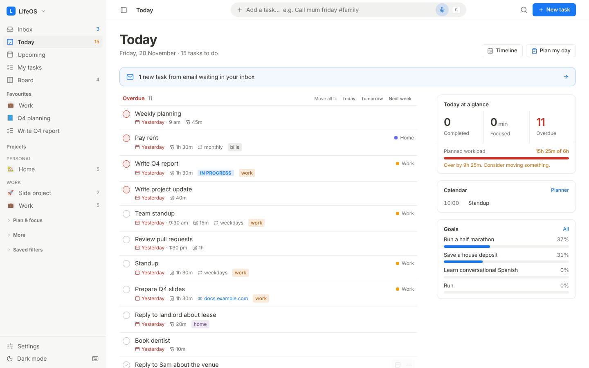
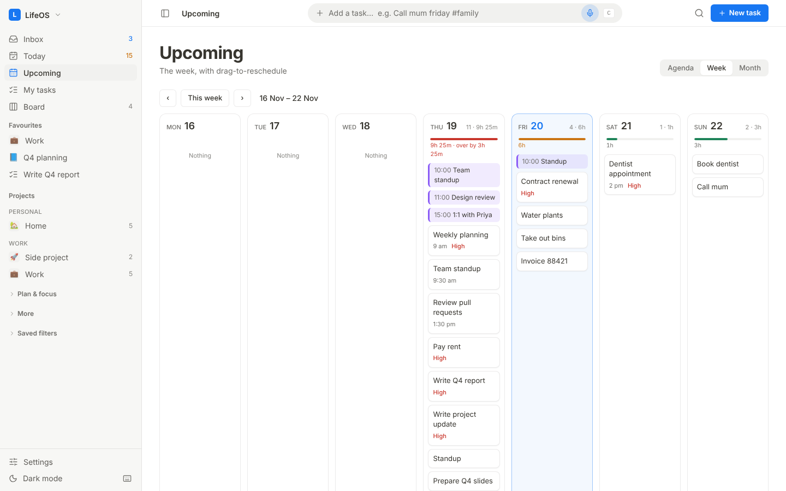
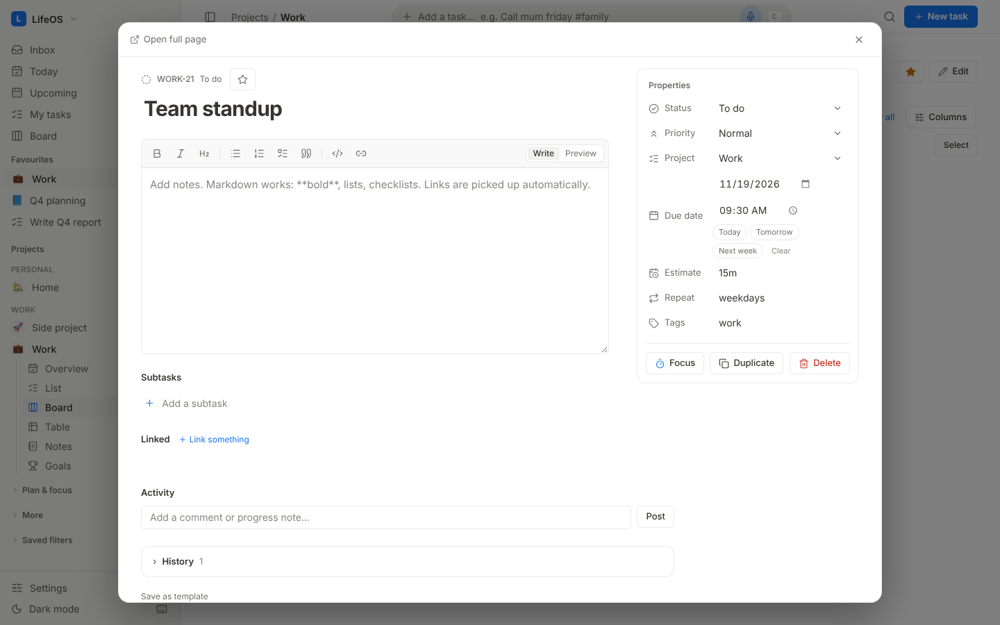
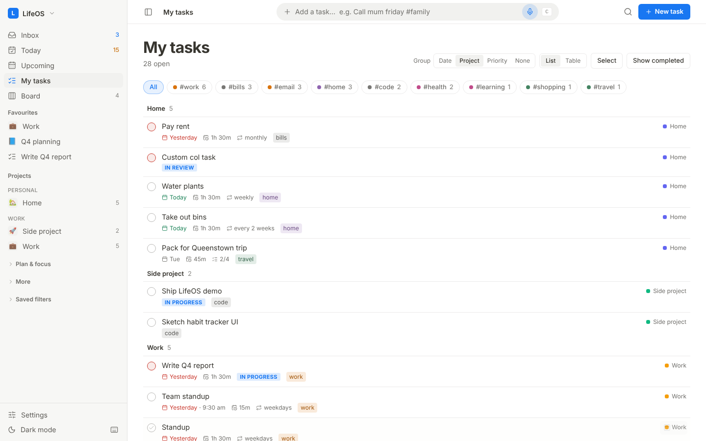
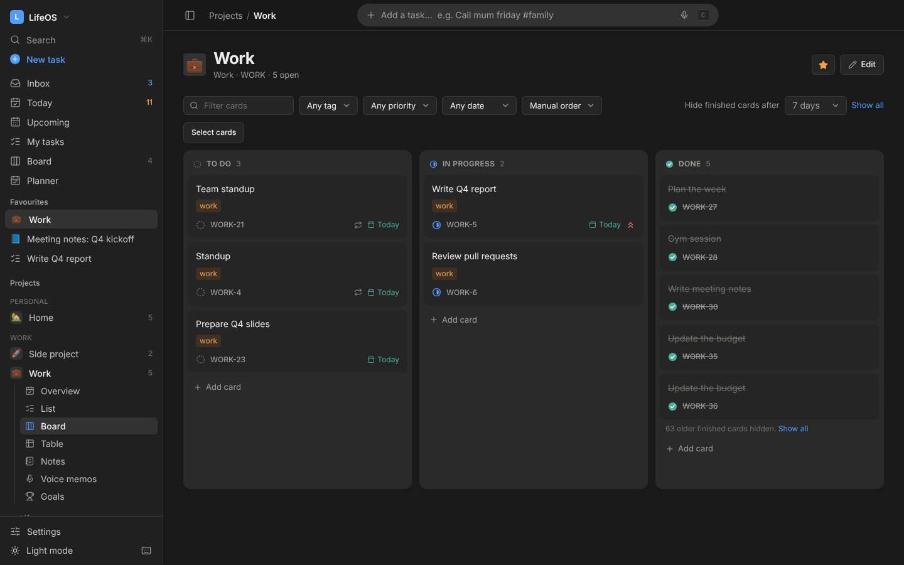
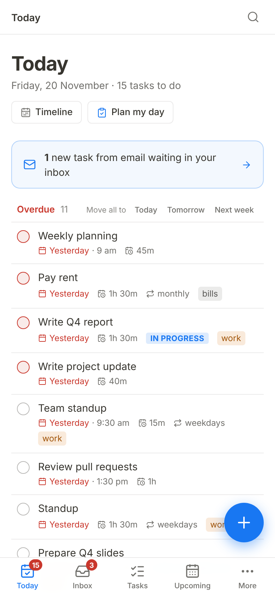

# LifeOS

A personal task and planning workspace for one person: fast capture, projects with boards and notes, and a clear view of how much work you have against how much time you have. Self-hosted, private, switchable feature by feature.

Next.js 15 · SQLite · a REST API, an MCP server for Claude, and a small background worker.

## Screenshots

| | |
|---|---|
|  **Today**: what's due, your workload against your day, calendar and goals |  **Week**: a workload bar on every day, drag tasks between days |
|  **Board**: compact cards, tick to complete, custom columns per project |  **Open a card in a pop-up**: edit everything without leaving the board |
|  **Projects** are workspaces: overview, list, board, table, notes, goals |  **Notes**: pages and sub-pages, links, history, icons |
|  **My tasks**: group by date, project or priority; move overdue in one click |  **Dark mode** |

On a phone it uses a bottom bar (which can hold a project of your choice), a slide-in menu with all your projects, one board column at a time, and a text-size setting:



(The screenshots use made-up demo data.)

## What it does

**Capture, fast**
- One **Add a task** bar everywhere. Type naturally: `Pay rent every month #bills @home !high 31 march at 9am ~30m`.
- **Voice:** hold the mic in the bar and talk, let go and the task is added (or tap to start and stop). Uses your browser's speech recognition.
- **Chrome extension** (download it from Settings → Connections): record from any tab without opening LifeOS, with a default project.
- **Email to tasks**, a **Telegram bot**, the **REST API**, iOS Shortcuts, the phone share sheet, and **Claude** over MCP.

**Plan your time**
- **Today** with a workload meter (estimates against your daily capacity), **Inbox**, **Upcoming** (agenda, week and month), and a **Planner** timeline that can auto-schedule into free slots around your calendar.
- **Workload bars** on every day of the week and agenda show when you're overbooked. **Move all overdue** to today, tomorrow or next week in one click, or triage them one by one in **Plan & review**.
- **Focus**: a Pomodoro and timers that keep running while you move around the app, with a countdown in the top bar.
- **Reminders**: a browser notification with **Mark done** and **Snooze** (15 minutes by default) while LifeOS is open, plus ntfy or webhook push and a morning brief from the worker.
- **Calendar sync** (read-only, from any private `.ics` link) and a subscribable **iCal feed** of your tasks.

**Organise**
- **Projects** with their own overview, list, board, table and notes. Group them into **areas**, give them an emoji, reorder them by dragging, pick the view they open to, and drag any task onto a project in the sidebar to move it.
- **Boards** with custom columns (per project if you like), filters, sorting, bulk edit, drag between columns, tick to complete. **Automations**: for example, on the due date move the card to your Today column, at the top. Boards also **update live** across your tabs and devices.
- **Notes**: Markdown, `[[links]]`, pages and sub-pages, backlinks, version history, and conflict protection if two devices edit at once.
- **Goals** with key results, **Templates** (a task plus its checklist in one click), **Tags** (rename, merge, recolour; they keep the capitals you type), **Favourites** pinned in the sidebar, **links** between any tasks, notes and goals.
- Subtasks (editable in place), repeating tasks, saved searches with operators (`#tag @project due:week is:overdue no:date has:link`), manual ordering, trash with undo.

**Look back**
- **Insights** (completion heatmap, streaks, focus time), an **Activity** log, and history on tasks, notes and goals (typing a title is one entry, not one per keystroke).
- Export everything as JSON or CSV, export voice memos to PDF (print to PDF), import from Todoist, CSV, or Markdown (Notion exports).

**Your data, safe**
- Encrypted, verified backups to your own Cloudflare R2 bucket, with a one-click restore and undo.
- Every upgrade makes a copy of your database first. Schema changes are additive.
- Features that have been removed over time (habits, journal, budgets, subscriptions, people, news, music, weather) leave their data in the database and in the JSON export; nothing is deleted.

## Run it

```bash
npm install
npm run dev                      # http://127.0.0.1:3000
npm run build && npm start       # production, binds 127.0.0.1
npm run worker                   # reminders, morning brief, calendar sync, email polling, backups (optional)
npm run mcp                      # MCP server for Claude and other bots (optional)
LIFEOS_DB=data/demo.db npm run seed   # fill a demo database
npm test                         # unit and upgrade tests
```

Data lives in `data/lifeos.db` (override with `LIFEOS_DB`).

## Deploy and update

Docker Compose + Cloudflare Tunnel + Access is the recommended setup. See **[docs/DEPLOY.md](docs/DEPLOY.md)** for sizing, setup, security and recovery.

**Update:** run `./update.sh` in your checkout. It pulls, builds the image once (web, worker and MCP share it), restarts what changed and tidies old images. It skips the build only when the running image was already built from the latest commit. The image is built in stages with cached dependencies and no compiler step, so after the first build an update is mostly the Next.js compile. The script prints how long the build took; if it is still slow, `docker compose build --progress=plain web` shows which step.

**Fastest:** run it without Docker. The Next.js build cache stays in the folder, so an update is usually under a minute:

```
git pull && npm ci && npm run build && sudo systemctl restart lifeos lifeos-worker lifeos-mcp
```

(or `pm2 restart all`; run `npm start`, `npm run worker` and `npm run mcp` under systemd or pm2 with the same `.env`.)

## Switch features on and off

**Settings → Features.** Everything except Today, Inbox, My tasks and Settings can be turned off: Upcoming, Board, Plan & review, Insights, Planner, Templates, Voice, Goals, Notes, Focus, Calendar sync, Telegram, the AI assistant (off by default), Email import, Reminders and the REST API. A switched-off feature disappears from the sidebar, mobile nav, command palette, Today, the MCP tools, the REST API and the worker. Data is kept if you turn it back on.

Settings is organised into tabs: **General** (features, time and capacity, layout, theme), **Reminders**, **Connections** (extension, email, API, calendar, Telegram, AI) and **Data & backup** (backup, import, export, archived projects).

## Shortcuts

`⌘K` search and commands · `C` or `/` quick add · `[` hide the sidebar · `g` then a letter to jump (e.g. `g t` Today, `g b` Board) · `J/K` move, `X` complete, `E` edit, `T` tomorrow in lists · `?` for the full list.

## Integrations

| What | How |
|---|---|
| **Claude / MCP** | `LIFEOS_MCP_TOKEN=$(openssl rand -hex 24) npm run mcp`, then `tailscale serve --bg --https=8443 http://127.0.0.1:3737` and `claude mcp add --transport http lifeos https://<machine>.<tailnet>.ts.net:8443/mcp --header "Authorization: Bearer <token>"`. Tools follow the feature switches. Never use `tailscale funnel`. |
| **REST API** | Settings → Connections → API → create a token (read or write, limited to areas, with an expiry). `POST /api/v1/tasks {"text":"Call mum tomorrow at 5pm"}`, `GET /api/v1/tasks?q=`, `PATCH/DELETE /api/v1/tasks/:id`, `POST /api/v1/tasks/:id/complete`, `/search`, `/brief`, `POST /api/v1/voice`. |
| **Chrome extension** | Download from Settings → Connections. The recorder opens from the toolbar icon (or Alt+Shift+V), sends text to `/api/v1/voice`, and can file everything under a default project. The microphone is allowed once on its options page. See `extension/README.md`. |
| **Email to tasks** | Webhook: POST any email (Postmark, Mailgun, SendGrid, JSON, or raw RFC 822 from a Cloudflare Email Worker) to the URL in Settings. Or IMAP: set `LIFEOS_IMAP_HOST/USER/PASS` (+ `_MAILBOX`, `_FLAGGED_ONLY=1`) and run the worker. The subject accepts quick-add syntax; `tasks+work@` adds the tag `work`; duplicates are skipped. |
| **Calendar** | Subscribe to the iCal URL in Settings from Google, Apple or Outlook. To show your own calendars in LifeOS, paste a private `.ics` link under Calendar sync (read-only, refreshed by the worker). |
| **Push** | ntfy topic and/or any webhook; due-time reminders and a morning brief. Needs `npm run worker` and `LIFEOS_BASE_URL` for tap-through links. |
| **Telegram** | Create a bot with @BotFather, paste the token in Settings, send the shown `/start <code>` to link your chat. Polling by default (no public URL needed). Free text adds a task; `/today /inbox /done 12 /search /brief`. |
| **AI assistant** | Off by default. Set `ANTHROPIC_API_KEY` and switch it on: smart paste, plan-my-day and ask. Text is sent to Anthropic only when you press a button. |

## Backup to Cloudflare R2

Settings → Data & backup. In Cloudflare: **R2 → Create bucket**, then **Manage R2 API tokens → Create token** with *Object Read & Write* limited to that bucket. Paste the account ID, bucket, access key ID and secret, and choose an **encryption passphrase** (write it down: without it a backup can't be opened). Press *Test connection*, then *Back up now & verify*.

Each backup is a consistent snapshot, integrity-checked, compressed, encrypted with AES-256-GCM and uploaded, then **downloaded again and verified** before it counts. Nothing is deleted unless the new backup verified. The worker repeats it on your schedule, keeps the newest N, and sends a push if one fails. **Restore** swaps your data inside a single transaction after saving your current data so you can **Undo**.

## Security

No login in the app: put it behind Cloudflare Tunnel + Access and set `LIFEOS_REQUIRE_CF_ACCESS=1` to refuse anything without the Access identity. `/api/v1`, `/api/inbound` and `/api/ical` use their own token or secret, so add an Access bypass for those paths. Tokens are scoped and expiring, bad credentials are rate limited, and the MCP server fails closed. Details in `docs/DEPLOY.md`.

## Design

Light and dark (follows your system), Inter, Lucide icons, Sonner toasts. Installable as a PWA.
